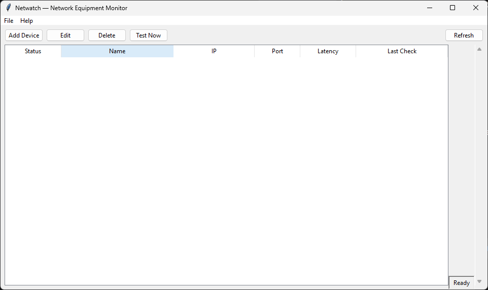

# Netwatch

<p align="center">
  
</p>

<p align="center">
  <em>A local, offline-first desktop monitor for network equipment.</em><br>
  Checks devices and service ports. Alerts you by email when something goes down.
</p>

<p align="center">
  <a href="https://ko-fi.com/claudiotavares">
    
  </a>
</p>



## Why Netwatch?

I'm Claudio, a software analyst from Brazil. I built Netwatch to solve two real problems:

1. **The professional one** — I provide IT support for small businesses, and there's no easy way to monitor their network devices without spinning up a Linux server or paying for enterprise software.
2. **The personal one** — I don't own a car, and I live in a big Brazilian city where even a used car costs a small fortune.

Netwatch is my solution to the first problem. **If it helps you too, you can support me on the second.** Every donation goes toward a down payment on my first car. 🚗

## Features

- **Device monitoring** — Track up to 5,000 devices with TCP port checks and ICMP fallback
- **Accurate state detection** — Distinguishes between *host down*, *port blocked*, and *timeout*
- **Email notifications** — Per-device routing, edge-triggered (no alert spam), with a customizable reminder interval
- **Grouping and search** — Organize devices into groups and filter instantly
- **Live latency** — See exactly how long each TCP connection takes
- **Local and private** — TinyDB storage, no cloud, no telemetry, no phone-home
- **Runs in the background** — Minimize to the system tray and keep monitoring all day
- **One-file app** — A single `.exe`, no Python installation required

## Tech Stack

- **Python 3.11+** — Application logic
- **Tkinter** — Native desktop GUI
- **TinyDB** — Document store (JSON-backed)
- **icmplib** — ICMP checks without raw sockets
- **pystray + Pillow** — System tray integration
- **PyInstaller** — Packaging to a single `.exe`

## Download

The latest release is available on the [Releases page](https://github.com/ClaudioTvares/netwatch/releases).

- **Windows**: [Download Netwatch.exe](https://github.com/ClaudioTvares/netwatch/releases/latest)

## Development

Clone the repo and set up the development environment:

```bash
git clone https://github.com/ClaudioTvares/netwatch.git
cd netwatch
python -m venv .venv
.\.venv\Scripts\Activate.ps1
pip install -r requirements.txt
python main.py